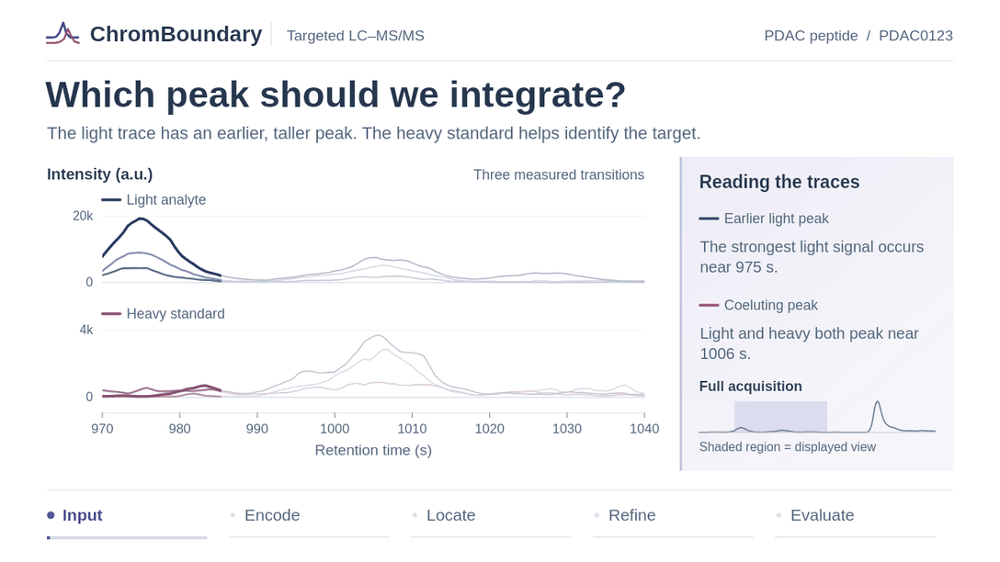
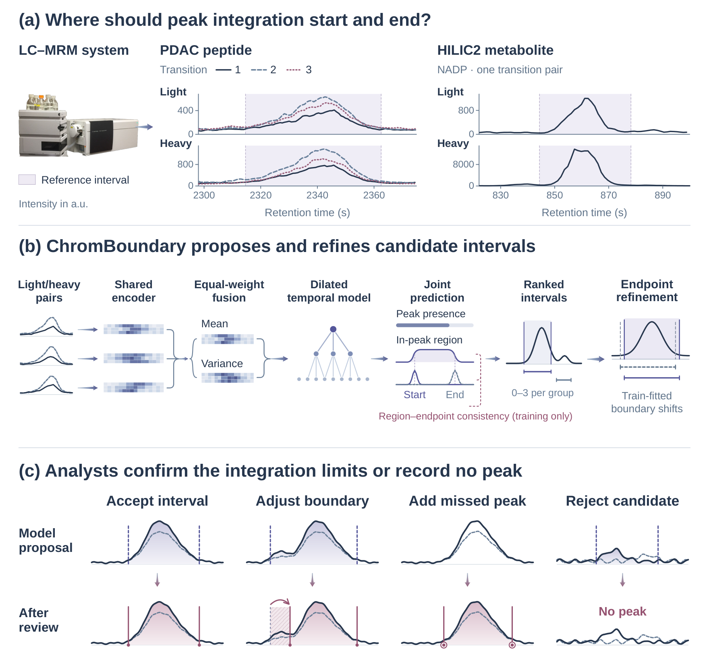

# ChromBoundary

**Locating peak boundaries in targeted LC–MS/MS by deep temporal segmentation of paired chromatograms**

ChromBoundary encodes paired light and heavy transitions, pools their features across transitions, and estimates peak occupancy and both endpoints along the retention-time axis. A learned correction refines the boundaries of each ranked interval.





## Quick start

```bash
python -m pip install .
chromboundary predict --model pdac --signals data/eoc_example.csv.gz --out predictions.csv
chromboundary evaluate --predictions predictions.csv --references data/eoc_reference.csv
```

| Model | Training data |
| --- | --- |
| `pdac` | PDAC peptides |
| `hilic2` | HILIC2 metabolites |
| `hilic_joint` | HILIC2 and HILIC1a metabolites |

For your own chromatograms, use a CSV with `group_id,transition,channel,time_s,intensity`. Each transition has a `light` and a `heavy` trace. Predictions contain up to three ranked intervals in seconds. Rank zero denotes a group with no predicted interval.

## Train

```bash
python -m pip install ".[data,train]"
python data/prepare_hilic.py --panel HILIC2 --out datasets/hilic2
chromboundary train --profile metabolite --signals datasets/hilic2/signals.npz --references datasets/hilic2/references.csv --out runs/hilic2.pt
```

Pass a saved checkpoint to `--model` for prediction. Add `--device cuda` to train or predict on a GPU.

[Study data and reproduction commands](data/README.md)
